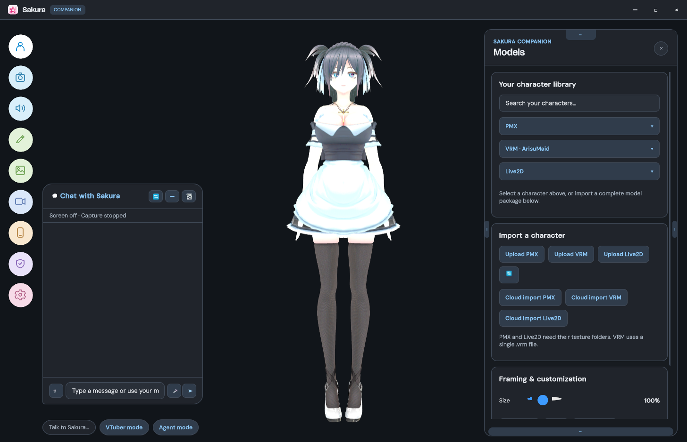
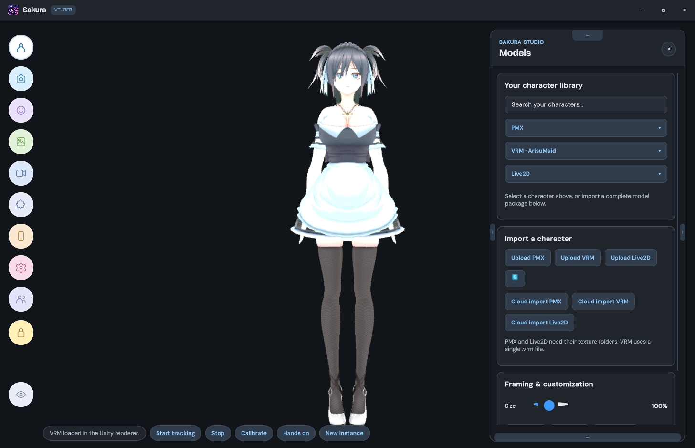
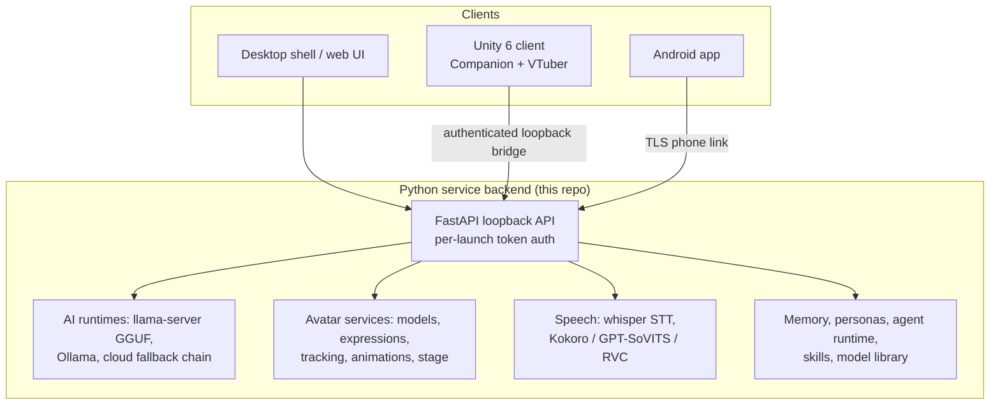

<p align="center">
  
</p>

<h1 align="center">Sakura</h1>

<p align="center">
  A local-first AI character companion, VTuber studio and approval-based desktop agent.<br>
  Your character models, your voice, your hardware — no cloud account required.
</p>

<p align="center">
  
  
  
  
  
  <a href="https://github.com/soulofswords/Sakura-Downloads/releases"></a>
</p>

<p align="center">
  
  
</p>

<p align="center"><sub>Companion and VTuber editions running on the Unity 6 client, powered by the Python service backend in this repository. <a href="#migrating-to-unity">Migration status below.</a></sub></p>

## What is Sakura?

Sakura is a desktop anime-character companion that talks, listens, remembers and reacts — and a full webcam VTuber studio in the same application. It renders **Live2D Cubism, PMX (MMD) and VRM** characters, tracks your face, shoulders and arms from a webcam or phone, and speaks with on-device speech synthesis. Conversation runs on a **local LLM by default** (a shipped Qwen3-VL GGUF served by its own llama-server), with Ollama imports and an ordered cloud fallback chain when you want one.

Everything sensitive stays on your machine: API keys live in Windows DPAPI / macOS Keychain, the backend binds to loopback with a per-launch token, and memory, personas and model libraries are local files you own. The project ships as separate **Companion**, **VTuber** and **Android** products from one codebase, with an approval-gated **Agent mode** that can operate the desktop on your behalf.

## Editions

| Edition | What it is |
|---|---|
| **Companion** | Always-on desktop companion: transparent widget window, chat, voice, memory, reminders, screen awareness, Agent mode |
| **VTuber** | Streaming studio: webcam/phone tracking, expressions, animations, stage props, Twitch/YouTube integration, VMC/NDI/Spout output |
| **Agent** | Approval-based desktop agent with learnable skills, an embedded browser, workspace files and per-task run modes |
| **Mobile** | Android client: phone-as-tracker, phone-local models and chat, authenticated TLS model transfer from the PC |

## Feature highlights

- **Three renderers, one avatar API.** Live2D Cubism (with a VTube Studio `.vtube.json` port: motion groups, hotkeys, framing and parameter gains), PMX with MMD-style physics, and VRM 0.x/1.0. Expressions, blend-shape lip sync, outlines, idle breathing/blinking, stage props and 3D backgrounds.
- **Tracking and streaming.** Webcam face/shoulder/arm tracking with calibration, phone as a tracker, NVIDIA Broadcast/AR SDK support, virtual camera, VMC protocol send, NDI and Spout output, Twitch EventSub + channel points, YouTube and Telegram chat bridges.
- **Voice.** faster-whisper speech recognition with wake word, Kokoro ONNX TTS, GPT-SoVITS and optional RVC voice conversion; emotion tags drive both face and voice; English and Hindi conversation.
- **Local-first AI.** Shipped Qwen3-VL-4B GGUF on a bundled llama-server, Ollama model import, ordered cloud fallback, a VRAM guard that hands the GPU to your games, and a persona LoRA fine-tuning track.
- **Memory and persona.** Vector-recall long-term memory with eviction, soul/persona/taste profiles, relationship state, character-card import/export.
- **Agent mode.** A desktop agent that asks before it acts: skills it can learn and export, an embedded authenticated browser, workspace file tools, task history and per-task approval modes.
- **Production hygiene.** Encrypted backups, Google Drive model backup, split Windows installers and a signed Android APK, SHA256-verified release publishing.

## Architecture



The web UI and the Unity client are thin clients: rendering and input live in the client, while AI, memory, agent logic and the model library stay in the Python backend behind a token-authenticated loopback API (`local_api_security.py`). That split is what lets the project migrate its renderer to Unity without rewriting its intelligence — see [Migrating to Unity](#migrating-to-unity).

## Engineering notes

Points a reviewer may want to open first:

- **Loopback security** — `local_api_security.py`: per-launch desktop token, tracking-only guard middleware, TLS phone link with certificate pinning on the Android side.
- **GPU single-residency** — `game_detection.py`, `gpu_routing.py`: detect game launch, unload the local model, hand the VRAM over, restore afterwards.
- **Memory that forgets correctly** — `memory_vectors.py`: vector-recall long-term memory with eviction, covered by regression tests in `tests/`.
- **Verification culture** — the pytest suite below plus 200+ browser-level `tests/*.cjs` gates (80 Playwright-driven) run against the real UI; the Unity client carries a built-player harness that counts rendered pixels to catch build-time shader stripping (a bug class that silently ships invisible models).
- **Release pipeline** — `tools/build-split-installers.py`: fingerprinted source, per-edition install/uninstall smoke tests, digest-verified publishing to [Sakura-Downloads](https://github.com/soulofswords/Sakura-Downloads).
- **Credentials never in the repo** — `credentials.py` stores keys in DPAPI/Keychain; models, weights, artwork and private configuration are deliberately excluded from Git.

## Run from source (Windows)

Python 3.12 and Git required:

```powershell
git clone https://github.com/soulofswords/Sakura.git
cd Sakura
python -m venv venv
.\venv\Scripts\python.exe -m pip install -r requirements.txt
.\venv\Scripts\python.exe desktop.py
```

`run_gui.bat` starts the web interface instead. Import your own character models in-app; add a cloud key in Settings or download the optional local model — webcam-only tracking needs no LLM at all. Apple Silicon setup: [docs/MACOS.md](docs/MACOS.md).

## Tests

```powershell
.\venv\Scripts\python.exe -m pytest tests -q     # backend + logic suite
npm install                                      # once, for the browser gates
node tests/<name>.cjs                            # UI-level checks against the real app
```

Latest full-suite receipt (2026-11-16, run on the maintainer's development tree, which is ahead of this public snapshot): **2,278 passed, 2 skipped, 4 failed** in 4 m 25 s, plus 295 subtests. The four reds are integration artifacts, not core regressions: two live-service checks (MCP over HTTP, TLS phone pairing) pass once the machine's `NO_PROXY` bracketed-IPv6 entry is sanitized (a known httpx parsing trap), and two snapshot pins match the committed tree but diverge from uncommitted, in-flight Android/starter-skill edits.

The browser gates read Playwright from this folder's `node_modules`; they are development-only and never ship in a build. Some model-validation tests need locally imported characters and skip otherwise.

## Migrating to Unity

The renderer and desktop window are moving to **Unity 6 (URP)** for native transparent-window compositing, GPU-side avatar rendering and a single codebase for Windows and Android. The migration lives in its own repository:

**→ [github.com/soulofswords/Sakura-Unity](https://github.com/soulofswords/Sakura-Unity)**

- **What moved:** UI, avatar viewport (UniVRM, Cubism, MMD loader), window transparency/placement, tracking rig, stage and the Agent panel — rebuilt as Unity C# clients of the same backend.
- **What stayed:** all Python services — AI, memory, personas, agent runtime, skills, model library, speech — reached through an authenticated loopback bridge (`Tools/backend_bridge.py` in the Unity repo).
- **How it is verified:** a built-player harness (`--sakura-verify`) loads real models, counts rendered pixels, exercises panels and writes JSON reports + screenshots; both editions are rebuilt and re-verified on every rendering change. VRM, PMX and Live2D rendering, transparent Companion window and mode isolation are verified in the shipped players.
- **Status:** active migration; the Python app remains the reference implementation and the service backend for both clients. Parity gaps are tracked in the Unity repo's docs.

## Downloads and documentation

- **Installers + APK:** [Sakura-Downloads releases](https://github.com/soulofswords/Sakura-Downloads/releases) (v2.1: Companion, VTuber, Android).
- **Project site:** [soulofswords.github.io/Sakura-website](https://soulofswords.github.io/Sakura-website/).
- **User guides:** [Companion](docs/user-guides/companion.md) · [VTuber](docs/user-guides/vtuber.md).
- **Agent skills:** [docs/AGENT-SKILLS.md](docs/AGENT-SKILLS.md) · **Workspace:** [docs/AGENT-WORKSPACE.md](docs/AGENT-WORKSPACE.md).

## Roadmap

- Finish Unity client parity (remaining panel and tracking edge cases) and make it the default desktop shell.
- Ship the persona LoRA as a selectable local voice/personality model.
- Deepen Agent mode: errand workflows and per-task model memory.
- Android parity for the Unity client.

## Feedback and contributing

Issues and pull requests are welcome — see [CONTRIBUTING.md](CONTRIBUTING.md). Report vulnerabilities privately via [SECURITY.md](SECURITY.md). Community chat: [Discord](https://discord.gg/kgxeMRFWDw).

## License

Sakura's original application source is licensed under **GNU GPL v3.0** — see [LICENSE](LICENSE), with the narrow optional Live2D integration permission in [LICENSE-EXCEPTIONS.md](LICENSE-EXCEPTIONS.md). Third-party libraries, SDKs and renderers (Live2D Cubism, UniVRM, MMD tooling, whisper, Kokoro, and others) retain their own licenses; see [THIRD_PARTY_NOTICES.md](THIRD_PARTY_NOTICES.md). Live2D Cubism Core remains proprietary and is not relicensed. Character models, artwork, voice weights and LLM weights are **not** included in this repository and remain under their creators' licenses — importing them does not grant redistribution rights.

---

<p align="center"><sub>Designed, built and maintained by <a href="https://github.com/soulofswords">soulofswords</a>.</sub></p>